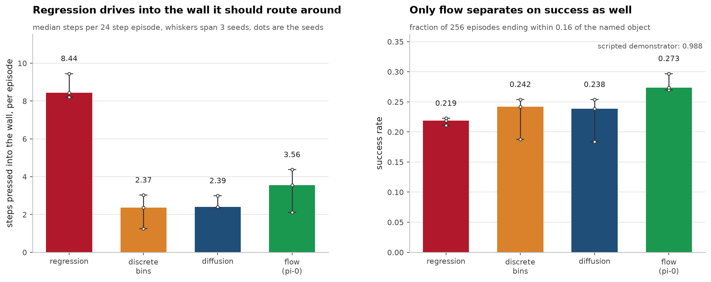
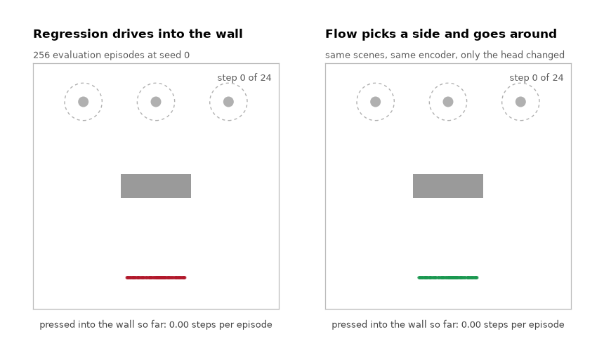
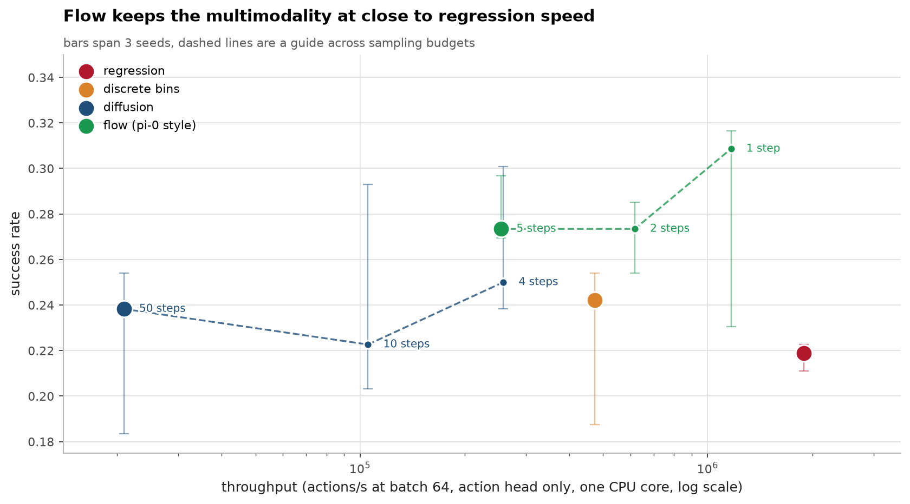
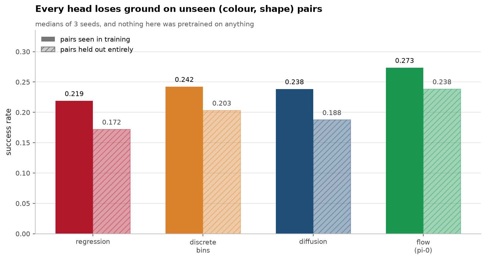

# vla-from-scratch

[](https://doi.org/10.5281/zenodo.23003685)

I compared four ways for a policy to output continuous actions, all under the
same conditions. They are discrete bins as tokens (RT-2), a regression head, a
diffusion policy head, and a flow matching action expert (pi-0).

That comparison is my own work rather than a reimplementation, and it runs on a
laptop CPU. The part that makes a VLA a VLA doesn't run here, and I say so in the
next section before showing any numbers.



## Scope, stated first

A real VLA puts a pretrained 1B to 3B vision language model in front of the
action head. The idea is that web scale pretraining gives robots *semantic*
generalisation. This repo doesn't test that, and it can't. My encoder is a small
CNN plus token embeddings, trained from scratch on 19,200 transitions of a 2D
task. Nothing is pretrained, so there's no transfer to measure.

I also don't use LIBERO or ManiSkill. The simulator is a 24x24 pixel 2D reaching
task that I wrote myself so the repo doesn't depend on a simulator.

What's left after cutting all that is a practical question. If perception is the
same, how should a policy represent a continuous action? Every head below uses
the same features and is trained with the same optimiser for the same number of
steps. So any difference between them comes from the action representation.

I put this section first because [`METHODOLOGY.md`](METHODOLOGY.md) asks me to write "not
measured" instead of extrapolating, and generalisation is the thing I didn't
measure here.

## The task, and why it has an obstacle

The agent starts at the bottom, there are three objects at the top, and the
instruction names one of them by colour and shape. There's a wall in the middle.

I added the wall on purpose. A demonstrator can go around it on the left or the
right, and both are correct, so the demonstrations are multimodal. I measured it
on the demonstrations, over the steps where the demonstrator is still going
around the wall. The left mode's lateral action averages -0.44, the right mode's +0.44, and the two
together average -0.004, which points straight at the wall.

That last number is what the experiment hinges on. A regression head trained with
mean squared error converges to the conditional mean, so on this data it learns
to drive into the obstacle. If the data weren't multimodal, regression would win
and the comparison wouldn't tell me anything.



This shows all 256 evaluation episodes at seed 0 playing at once. Both sides use
the same scenes and encoder, and only the action head differs. A dot turns black
on a step where the wall blocked the move it asked for. The counters end on 8.44
collisions per episode against 3.56, which are also the medians across the three
seeds.

## Results
3 seeds, 800 demonstrations each, 2000 gradient steps per head, 17 minutes on a CPU.
Every figure below is recomputed from the committed results by separate
implementations in `verify/`, and CI fails if any of them disagree.

The mode averaging prediction held up. Regression spends 8.44 steps of a 24 step
episode pushed into the wall. Every multimodal head spends between 2.05 and 3.56,
and the seed ranges don't overlap. On success, only flow separates from
regression, 0.273 against 0.219. The other two heads land in between and overlap.
All four are far below the scripted demonstrator's 0.988, so the collision
numbers show the mechanism, but none of the heads solves the task.

The discrete bins figures come from an older version of that head. It conditioned
on the raw action in training and on bin centres when sampling. I've fixed that,
but I haven't rerun those figures yet.

More in the [method notes](notes/METHODS.md#results).

## Sampling error

The two mode figures are single estimates from 800 demonstrations, so they have
their own sampling error, which I hadn't measured at first. I resimulated the 800
demonstration protocol 2000 times from its own generator, 38,400,000 simulated
steps in total. That puts the population values at -0.43997 and +0.43981 with sd
0.005, and the pooled mean at -0.00035 with sd 0.017. So the pooled mean being near
zero comes from the design, but the exact digit doesn't mean much. All three
seeds land within 1.7 sd of the reference.
## Latency is where flow earns its place
Here is each head at its default sampling budget, from `results/heads.csv`.

| head | NFE | actions/s, batch 64 | vs regression |
|---|---:|---:|---:|
| regression | 1 | 1,891,644 | 1.0x |
| discrete bins | 2 | 472,761 | 4.0x slower |
| flow, 5 steps | 5 | 254,558 | 7.4x slower |
| diffusion, 50 steps | 50 | 20,913 | **90x slower** |

These numbers are throughput, which isn't the same as a robot's control rate.
`latency()` in `vla/eval.py` samples 64 scenes in one call and divides the time by
64, so each figure is actions per second at batch 64. A single robot runs at
batch 1, which costs more per action, and I haven't measured that. I mainly use
these tables to compare heads with each other.

Sweeping the sampling budget is where it gets interesting. The table below comes
from a second harness, `results/step-sweep.csv`, so its flow 5 step row doesn't
match the one above exactly. It gives 0.266 success and 251,679 actions/s, against 0.273 and 254,558 in the
main run. It's the same head, timed in two separate runs.

| head | steps | success | actions/s, batch 64 |
|---|---:|---:|---:|
| diffusion | 50 | 0.238 | 20,985 |
| diffusion | 10 | 0.223 | 105,379 |
| diffusion | 4 | 0.250 | 258,237 |
| flow | 5 | 0.266 | 251,679 |
| flow | 2 | 0.273 | 616,867 |
| **flow** | **1** | **0.309** | **1,167,180** |

Flow at one step is by far the fastest row here. It's 1.9x the next one, 4.6x
the flow 5 step row in the same table, and within 1.6x of regression's 1,891,644 in
the main run. It also has the highest median success, 0.309, but I don't think that
part holds up. Its three seeds are 0.230, 0.309 and 0.316. The 0.230 is the worst
of any flow row and is below the medians of flow at 5 steps and flow at 2 steps.
The full span covers the median of every other row in the table except diffusion
at 10 steps. The plot below shows those bars, and they overlap almost completely.
With three seeds I can't separate these configurations on success.

So I'll only make the narrow claim. Going from 5 flow steps to 1 costs no success
I can measure and gives 4.6x the throughput. I can't say one step is better.



More in the [method notes](notes/METHODS.md#latency-is-where-flow-earns-its-place).

## Generalisation



I held three (colour, shape) pairs out of training completely. Every head drops.
Flow goes from 0.273 to 0.238 and regression from 0.219 to 0.172. Nothing here was
pretrained, so this only measures whether the heads learned the compositional
structure from 19,200 in-domain transitions. It says nothing about pretraining
transfer. The real version of this test is what would justify putting a VLM in
the loop, and for that I'd need the VLM.

## What I got wrong
I expected action chunking to fix the dithering, and it made things worse. My reasoning seemed fine. The demonstrator's choice of side can't be observed, so a head that samples independently every step can pick left, then right, and stall.
At chunk 6, flow fell from 0.246 success to 0.047 and its collisions went from
6.09 to 12.57. On a task this reactive, open loop execution piles up prediction
error faster than sticking to one mode helps. I wrote up two more mistakes in
the notes. One is a held out split that leaked until a test caught it, and the
other is an encoder I built without proprioception.

More in the [method notes](notes/METHODS.md#what-i-got-wrong).

## How to run it

```bash
python -m venv .venv && source .venv/bin/activate
pip install -r requirements.txt
```

```bash
python -m pytest tests/ -q
```

```bash
python -m experiments.main --seeds 0 1 2 --demos 800 --steps 2000
```

```bash
python -m bench.figures
```

The sweep takes about 17 minutes on an M4 CPU. I listed every setting of that run,
with the line each one comes from, in [notes/WHAT-RAN.md](notes/WHAT-RAN.md).
The figures read the committed results and never re-run an experiment. Only the
animation needs agent positions, so I saved those in
`results/rollout-traces.npz`. If you delete that file, the next
`python -m bench.figures` retrains two heads at seed 0 to rebuild it. That takes
about three minutes, and it won't write anything unless it reproduces the
committed `heads.csv` row exactly.

## Where things live

```
vla/envs.py      the 2D task, written directly, no simulator dependency
vla/data.py      scripted demonstrations, deliberately bimodal
vla/backbone.py  small vision language encoder, shared by every head
vla/heads.py     the four action representations, all chunk aware
vla/eval.py      closed loop rollouts and latency
experiments/     the sweep
bench/           the figures, and the plot style shared with my other repos
tests/           30 tests
```

## Papers

- **Brohan, Brown, Carbajal et al. RT-2: Vision-Language-Action Models Transfer Web Knowledge to Robotic Control. CoRL 2023.** [arXiv:2307.15818](https://arxiv.org/abs/2307.15818) The discrete bins as text tokens head.
- **Black, Brown, Darpinian et al. pi-0: A Vision-Language-Action Flow Model for General Robot Control. 2024.** [arXiv:2410.24164](https://arxiv.org/abs/2410.24164) The flow matching action expert, and the latency argument this repo measures.
- **Chi, Feng, Du et al. Diffusion Policy: Visuomotor Policy Learning via Action Diffusion. RSS 2023.** [arXiv:2303.04137](https://arxiv.org/abs/2303.04137) The diffusion head, and the clearest statement of why multimodality in demonstrations breaks regression.
- **Zhao, Kumar, Levine, Finn. Learning Fine-Grained Bimanual Manipulation with Low-Cost Hardware. RSS 2023.** [arXiv:2304.13705](https://arxiv.org/abs/2304.13705) ACT and action chunking, the idea my negative result above tested.
- **Kim, Pertsch, Karamcheti et al. OpenVLA: An Open-Source Vision-Language-Action Model. CoRL 2024.** [arXiv:2406.09246](https://arxiv.org/abs/2406.09246) The open reference point for the full system.
- **Liu, Zhu, Gao et al. LIBERO: Benchmarking Knowledge Transfer for Lifelong Robot Learning. NeurIPS 2023.** [arXiv:2306.03310](https://arxiv.org/abs/2306.03310) The benchmark this repo substitutes a toy for, and why that substitution costs the generalisation claim.

Related: in [rectified-flow-from-scratch](https://github.com/aghasalim/rectified-flow-from-scratch)
I built the flow matching parts that the pi-0 style head uses here.

## License

MIT, see [LICENSE](LICENSE).
